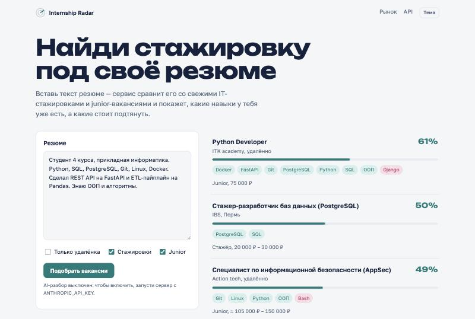
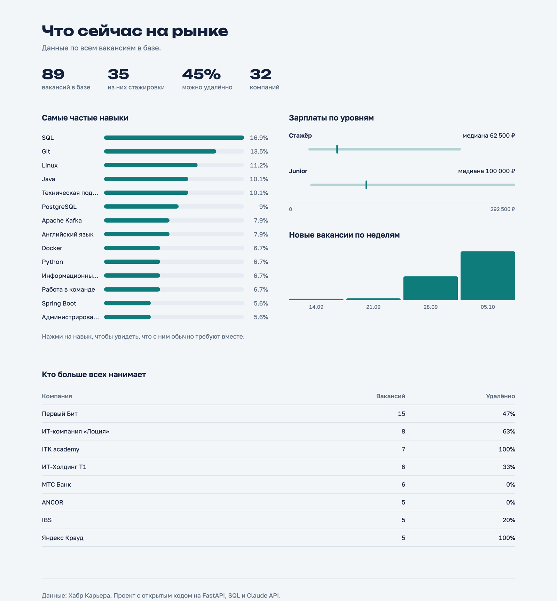
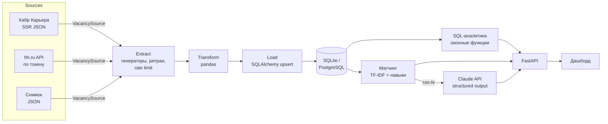

# Internship Radar

[](https://github.com/den123591/internship-radar/actions/workflows/ci.yml)


Сервис собирает IT-стажировки и junior-вакансии, считает аналитику рынка на SQL и подбирает
вакансии под резюме: показывает процент соответствия, какие навыки уже есть и каких не хватает.
По желанию Claude делает подробный разбор и пишет черновик сопроводительного письма.

> *Aggregator of IT internships with an ETL pipeline, SQL analytics and resume-to-vacancy matching
> (hand-written TF-IDF + optional Claude API).*



## Что умеет

- **Сбор данных.** Хабр Карьера (основной источник) и hh.ru (по токену). Вежливый скрейпинг: rate limit,
  ретраи с экспоненциальной задержкой, свой User-Agent, только разрешённые в `robots.txt` разделы.
- **ETL на pandas.** Дедупликация, канонизация навыков (`python3` → `Python`, `k8s` → `Kubernetes`),
  пересчёт вилок в рубли, отсев мусорных зарплат, идемпотентная загрузка в БД.
- **SQL-аналитика.** Топ навыков с `DENSE_RANK()`, медиана зарплат через `ROW_NUMBER()` (в SQLite нет
  `percentile_cont`), «премия» навыка к средней зарплате через `AVG() OVER ()`, недельный тренд с
  нарастающим итогом, частые пары навыков через self-join. Одинаково работает на SQLite и PostgreSQL.
- **Матчинг резюме.** TF-IDF и косинусная близость написаны с нуля, плюс покрытие навыков вакансии.
  Оценка объяснимая: видно, какие навыки совпали, а каких нет.
- **AI-разбор (опционально).** Claude API со структурированным ответом (Pydantic-схема): оценка,
  сильные стороны, пробелы, совет и черновик сопроводительного письма.
- **API и дашборд.** FastAPI с OpenAPI-документацией на `/docs`, одностраничный дашборд без фреймворков,
  светлая и тёмная темы.



## Быстрый старт

```bash
git clone https://github.com/den123591/internship-radar.git
cd internship-radar
python -m venv .venv && source .venv/bin/activate
pip install -e ".[dev]"

radar ingest --source sample        # снимок реальных вакансий из репозитория, без сети
radar ingest --source habr          # или свежие данные с Хабр Карьеры
radar serve                         # http://127.0.0.1:8000
```

Через Docker с PostgreSQL:

```bash
docker compose up --build           # http://localhost:8000
```

Чтобы включить AI-разбор, задайте `ANTHROPIC_API_KEY` в окружении или в `.env` (см. `.env.example`).

### CLI

```bash
radar ingest --source habr --query python --remote   # только удалёнка по запросу
radar stats                                          # краткая аналитика в JSON
radar match resume.txt --top 10                      # подбор вакансий в терминале
```

## Архитектура



```
src/radar/
├── sources/        # источники за общим протоколом VacancySource
│   ├── habr.py     # парсинг SSR-состояния страницы, пагинация
│   ├── hh.py       # официальный API hh.ru
│   └── sample.py   # офлайн-снимок для демо и тестов
├── etl.py          # extract → transform (pandas) → load
├── db.py           # схема SQLAlchemy 2.0, репозиторий, upsert
├── analytics.py    # SQL-запросы с CTE и оконными функциями
├── matching/
│   ├── tfidf.py    # TF-IDF, косинус, простой русский стеммер
│   ├── service.py  # ранжирование и объяснение
│   └── llm.py      # Claude API, структурированный ответ
├── api.py          # FastAPI
├── cli.py          # radar ingest | stats | match | serve
└── web/index.html  # дашборд
```

## Технические решения

| Решение | Почему |
|---|---|
| Парсим JSON из `<script data-ssr-state>`, а не HTML | Вёрстка меняется часто, структура данных редко. Парсер в 20 строк вместо хрупких CSS-селекторов. |
| Источники за `Protocol`, а не через наследование | Новый источник добавляется одним классом с методом `fetch()`. Генераторы позволяют не держать всё в памяти. |
| `transform()` — чистая функция над DataFrame | Легко тестировать без сети и БД. |
| SQLite по умолчанию, PostgreSQL в Docker | Проект запускается одной командой, а CI гоняет тесты на обеих СУБД, чтобы SQL оставался переносимым. |
| Свой TF-IDF вместо scikit-learn | Пара сотен документов, а зависимость тяжёлая. И это хороший способ разобраться, как всё устроено. |
| LLM только для топ-N после детерминированного ранжирования | Дешевле, быстрее и предсказуемее, чем гонять всю базу через модель. Без ключа сервис работает полностью. |
| hh.ru за токеном | С 2025 года hh закрыл анонимный доступ к поиску (API отвечает `403 forbidden`). Источник честно сообщает об этом, а не возвращает пустоту. |

## Тесты

```bash
pytest --cov=radar        # 41 тест, покрытие ~90%
ruff check src tests
```

Сеть в тестах не нужна: HTTP подменяется `httpx.MockTransport`, LLM — заглушкой, время в ретраях и
rate limiter внедряется через параметры. В CI отдельная джоба прогоняет тесты на PostgreSQL 17.

## Как я работал с AI

Проект сделан в паре с Claude Code: я ставил задачи, принимал архитектурные решения и проверял
каждый шаг. Подробно, с реальными ошибками, которые всплыли по ходу, описано в
[docs/ai-workflow.md](docs/ai-workflow.md).

## Что дальше

- [ ] Расписание сбора (cron или GitHub Actions) и история изменений вакансий
- [ ] Эмбеддинги вместо TF-IDF и сравнение качества на размеченной выборке
- [ ] Telegram-бот с уведомлениями о новых стажировках под резюме
- [ ] Миграции схемы через Alembic

## Лицензия

MIT
